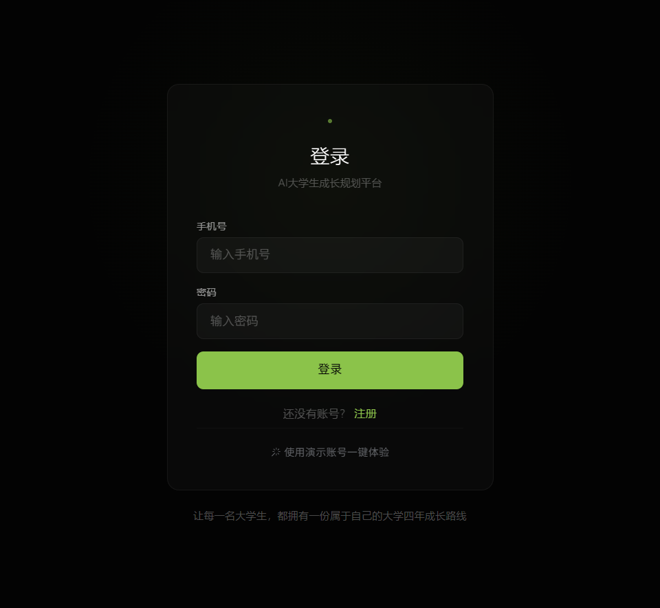
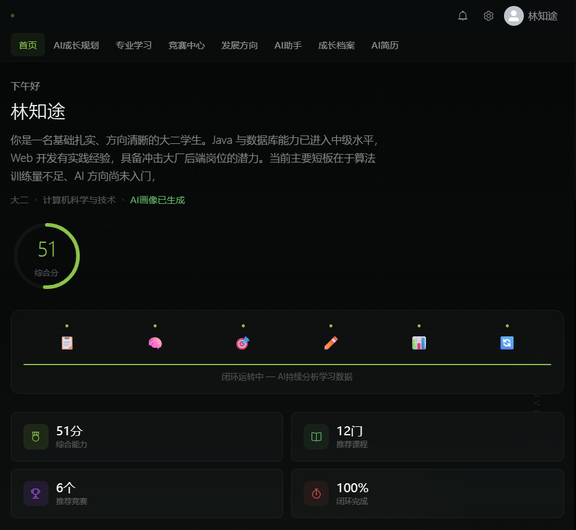
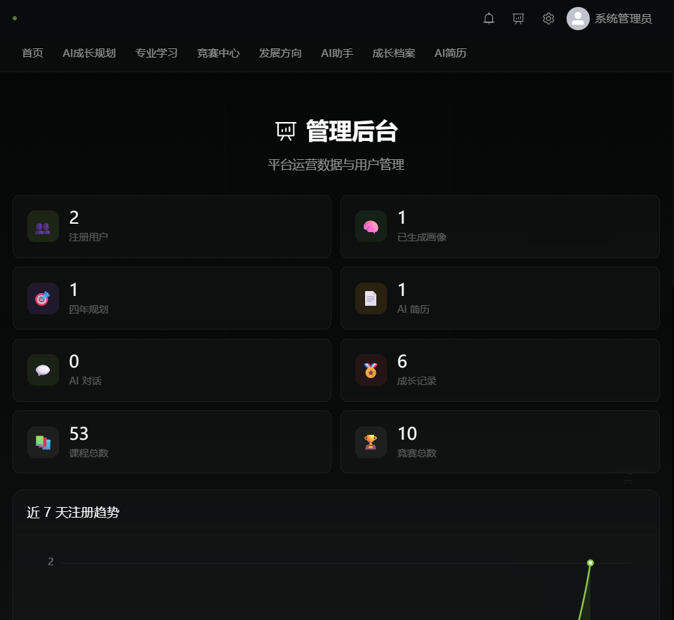

# 智途AI · 大学生成长规划平台

> 让每一名大学生，都拥有一份属于自己的大学四年成长路线。

智途AI 不是一个「套壳 AI 聊天网站」。它把大模型真正接进了大学生成长规划的完整业务闭环：
**采集学情数据 → AI 生成学生画像 → AI 生成四年规划 → 每日执行与打卡 → AI 分析进度并动态调整 → 沉淀成长档案 → 生成求职简历**。

---

## 一、它解决什么问题

作为大学生，我们真正焦虑的是这几件事，而它们通常只能在零散的帖子和经验贴里找答案：

| 真实痛点 | 智途AI 的解法 |
| --- | --- |
| 「我不知道自己现在是什么水平」 | AI 学生画像：把 9 项能力量化成雷达图，并直接指出优势与短板 |
| 「大一大二大三到底该干什么」 | AI 四年规划：分阶段给出目标、课程、技能、竞赛与风险提醒 |
| 「计划定了但坚持不下来」 | 每日学习计划 + 打卡，AI 根据完成情况自动重排后续任务 |
| 「比赛太多，不知道报哪个」 | AI 竞赛推荐：按画像打分排序，并说明「为什么推荐你参加」 |
| 「简历上没东西可写」 | 成长档案自动沉淀项目/竞赛/证书，一键生成结构化简历 |
| 「面试不知道怎么答」 | AI 模拟面试：像真实面试官一样提问并逐条点评 |

---

## 二、核心功能

- **AI 学生画像** —— 基于 9 项能力自评与学情数据生成多维度评估、优势短板与三个月行动建议
- **AI 大学四年规划** —— 大一到大四分阶段规划；针对就业 / 考研 / 保研 / 考公分别给出路线
- **AI 动态学习计划** —— 每日任务打卡，AI 读取完成率与课程进度后重新调度后续计划，弱项优先
- **AI 竞赛推荐** —— 学生画像驱动匹配，输出匹配度评分与个性化推荐理由
- **AI 简历生成** —— 汇总学习记录与成长档案，生成 A4 结构简历，支持直接打印 / 导出 PDF
- **AI 成长助手** —— 学习答疑、职业规划、竞赛咨询、模拟面试四种模式，**流式输出**打字机效果
- **专业知识地图** —— 按学生真实专业加载课程学习路线，可视化课程进度
- **成长档案** —— 项目、竞赛、证书、实习、荣誉五类记录统一归档与统计
- **站内通知** —— 竞赛报名提醒、画像更新提醒，导航栏未读红点与一键已读
- **管理后台** —— 平台运营看板（注册趋势 / AI 使用分布）+ 用户搜索分页、角色管理与数据级联删除

### 界面预览

| 登录 | 首页 |
| --- | --- |
|  |  |

**管理后台**（管理员登录后导航栏出现入口）



> 以上为实际运行截图，使用下方演示账号登录即可复现。

---

## 三、技术架构

```
                    ┌──────────────────────────────┐
   Vue 3 + Vite     │  视图层：11 个业务页面        │
   Element Plus     │  状态层：Pinia                │
   ECharts          │  通信层：Axios + fetch 流式    │
                    └──────────────┬───────────────┘
                                   │ JWT (Bearer)
                    ┌──────────────▼───────────────┐
   Spring Boot 2.7  │  Controller → Service → Mapper│
   Spring Security  │  MyBatis-Plus  /  全局异常处理 │
                    └──────┬────────────────┬───────┘
                           │                │
                  ┌────────▼──────┐  ┌──────▼─────────────────┐
                  │  MySQL 8.x    │  │  AI 服务层（可替换）    │
                  │  14 张表       │  │  DeepSeek / OpenAI /   │
                  └───────────────┘  │  通义千问（兼容协议）   │
                                     └────────────────────────┘
```

| 层次 | 技术选型 |
| --- | --- |
| 前端 | Vue 3、Vite 5、Vue Router 4、Pinia、Element Plus、ECharts |
| 后端 | Spring Boot 2.7、Spring Security + JWT、MyBatis-Plus 3.5 |
| 数据库 | MySQL 8.x（utf8mb4） |
| AI | 统一 `AIService` 接口，兼容任何 OpenAI Chat Completions 协议的服务 |

> **关于 AI 的可替换性**：所有 AI 能力都只依赖 `AIService` 这一个接口，
> 更换模型厂商只需修改 `application.yml` 中的三行配置，业务代码零改动。

---

## 四、快速开始

> **最省事的方式**：运行 `scripts/start-dev.ps1`（Windows）或 `scripts/start-dev.sh`（macOS / Linux），
> 脚本会检查依赖、启动前后端并打印访问地址；加上 `-InitDb` / `INIT_DB=1` 还能顺带建库。
> 也可以用 `docker compose up -d --build` 一键部署。详见 [docs/DEPLOY.md](docs/DEPLOY.md)。

### 0. 环境要求

- JDK 8 及以上（推荐 17）
- Node.js 18 及以上
- MySQL 8.x
- Maven 3.6 及以上

### 1. 初始化数据库（一条命令）

```bash
# Windows
powershell -ExecutionPolicy Bypass -File scripts/init-db.ps1 -DbPassword 你的密码

# macOS / Linux
DB_PASSWORD=你的密码 bash scripts/init-db.sh
```

脚本会依次执行 `database/` 下的三个文件，**均可重复执行，不会产生重复数据**：

| 文件 | 作用 |
| --- | --- |
| `schema.sql` | 建库建表（14 张表） |
| `majors.sql` | 专业字典（175 个专业，12 个学科门类） |
| `data.sql` | 课程、竞赛、知识点、演示账号与完整演示数据 |

### 2. 启动后端

```bash
cd backend
mvn spring-boot:run
```

后端地址：http://localhost:8080
健康检查：http://localhost:8080/api/health

如果数据库账号密码不是默认的 `root / 123456`，先设置环境变量：

```bash
# Windows
set DB_USERNAME=root && set DB_PASSWORD=你的密码

# macOS / Linux
export DB_USERNAME=root DB_PASSWORD=你的密码
```

### 3. 启动前端

```bash
cd frontend
npm install
npm run dev
```

访问 http://localhost:3000

### 4. 体验演示账号

登录页点击「**使用演示账号一键体验**」，或手动输入：

| 角色 | 手机号 | 密码 | 说明 |
| --- | --- | --- | --- |
| 学生 | `13800000000` | `123456` | 已预置画像、四年规划、7 天学习计划、6 条成长档案、AI 简历与站内通知 |
| 管理员 | `13900000000` | `123456` | 登录后导航栏出现「管理后台」入口，可查看平台统计与管理用户 |

学生账号登录后所有页面都有内容，无需先配置 AI Key。

### 5. 配置 AI 服务（可选，但强烈建议）

> **不配置也能跑通全部功能**，此时系统运行在「离线模板模式」：
> 画像与规划由内置规则生成，界面上会明确标注结果**不是大模型输出**，不会伪装成 AI 结果。

启用真实大模型有两种方式：

**方式一 · 用户在页面里配置（推荐）**
登录后进入「API 设置」，选择服务商并填入自己的 Key，点击「测试连接」通过后保存。
Key 按用户隔离存储，优先级高于系统配置。

**方式二 · 配置系统级 Key**

```bash
# Windows
set AI_API_KEY=sk-xxxxxxxx

# macOS / Linux
export AI_API_KEY=sk-xxxxxxxx
```

支持的服务商：

| 服务商 | API 地址 | 推荐模型 |
| --- | --- | --- |
| DeepSeek | `https://api.deepseek.com/v1` | `deepseek-chat` |
| OpenAI | `https://api.openai.com/v1` | `gpt-4o-mini` |
| 通义千问 | `https://dashscope.aliyuncs.com/compatible-mode/v1` | `qwen-plus` |

---

## 五、可配置项

所有配置均支持环境变量覆盖，默认值可直接用于本地开发。
完整清单见 [`.env.example`](.env.example)。

| 变量 | 默认值 | 说明 |
| --- | --- | --- |
| `SERVER_PORT` | `8080` | 后端端口 |
| `DB_HOST` / `DB_PORT` | `localhost` / `3306` | 数据库地址 |
| `DB_NAME` | `zhitu_ai` | 数据库名 |
| `DB_USERNAME` / `DB_PASSWORD` | `root` / `123456` | 数据库账号 |
| `AI_API_KEY` | 空 | 系统级 AI Key，留空则进入离线模板模式 |
| `AI_API_URL` | `https://api.deepseek.com/v1` | 兼容 OpenAI 协议的接口地址 |
| `AI_MODEL` | `deepseek-chat` | 模型名 |
| `AI_TIMEOUT` | `60000` | 单次请求超时（毫秒） |
| `AI_MAX_RETRIES` | `2` | 调用失败重试次数 |
| `JWT_SECRET` | 内置默认值 | **生产环境必须替换** |
| `SQL_LOG_IMPL` | 打印 SQL | 生产环境建议关闭 |

---

## 六、项目结构

```
zhitu-ai/
├── frontend/                  # Vue 3 前端
│   ├── src/
│   │   ├── views/             # 11 个业务页面
│   │   ├── layouts/           # 主布局（含顶端导航与背景）
│   │   ├── api/               # 接口封装（含流式对话）
│   │   ├── stores/            # Pinia 状态
│   │   ├── utils/             # axios 封装、Markdown 渲染
│   │   ├── data/              # 专业字典数据源（用于生成 SQL）
│   │   └── assets/style.css   # 深色玻璃设计系统
│   ├── public/                # 静态资源与 3D 背景场景
│   └── package.json
├── backend/                   # Spring Boot 后端
│   └── src/main/java/com/zhitu/
│       ├── controller/        # 12 个控制器
│       ├── service/impl/      # 业务实现（画像/规划/计划/推荐/简历）
│       ├── ai/                # AIService 接口 + DeepSeek 实现
│       ├── mapper/ entity/    # MyBatis-Plus 数据访问
│       ├── config/            # 安全、跨域、字段自动填充
│       └── utils/             # JWT、密码加密
├── database/                  # 数据库脚本（三层：结构 / 字典 / 业务数据）
├── docs/                      # 项目文档
├── scripts/                   # 一键初始化脚本
└── .env.example               # 环境变量清单
```

---

## 七、文档

| 文档 | 内容 |
| --- | --- |
| [docs/ARCHITECTURE.md](docs/ARCHITECTURE.md) | 系统架构、AI 调用链路、关键设计取舍 |
| [docs/API.md](docs/API.md) | 全部 REST 接口说明与请求示例 |
| [docs/DATABASE.md](docs/DATABASE.md) | 14 张表的设计说明与字段含义 |
| [docs/DEMO.md](docs/DEMO.md) | 演示脚本：5 分钟讲清项目亮点与操作顺序 |
| [docs/DEPLOY.md](docs/DEPLOY.md) | 部署手册：三种运行方式、Mock AI 验证、生产注意事项、排查表 |

---

## 八、开发进度

- [x] 项目初始化（前端 / 后端 / 数据库 / Git）
- [x] 用户系统（注册 / 登录 / JWT / 密码 BCrypt 加密）
- [x] 学生画像（AI 画像生成 + 能力雷达图）
- [x] AI 大学四年规划（分阶段 + 分目标路线）
- [x] 专业学习模块（知识地图 + 进度追踪）
- [x] 竞赛中心（筛选 + 倒计时 + 加入计划）
- [x] AI 竞赛推荐（画像驱动匹配评分）
- [x] AI 动态规划（每日打卡 + AI 分析 + 自适应重排）
- [x] 成长档案（五类记录归档 + 统计）
- [x] AI 简历（结构化生成 + A4 预览 + 打印导出）
- [x] 用户自配 API Key（多服务商 + 连接测试 + Key 脱敏）
- [x] AI 助手（4 种模式 + 流式输出 + Markdown 渲染）
- [x] AI 模拟面试（面试官提问 + 逐条点评）
- [x] 移动端适配
- [x] 站内通知中心（未读红点 + 标记已读）
- [x] 管理员后台（平台统计看板 + 用户搜索分页 + 角色管理 + 数据级联删除）
- [x] 单元测试（后端 21 个 / 前端 12 个）
- [x] 本地 Mock AI 服务（没有 Key 也能验证完整 AI 调用链路）
- [x] 容器化部署（Dockerfile + docker-compose.yml + nginx 配置）
- [x] 一键启动 / 停止脚本（Windows + macOS/Linux）
- [ ] 微信登录（需先申请微信开放平台资质，当前未实现）

---

## 九、已知限制

项目保持诚实，以下是当前版本的真实边界：

- **离线模板模式**：未配置 API Key 时，画像与规划由内置规则生成，覆盖面有限，
  界面上会明确标注，不会冒充大模型输出。
- **竞赛日期**：`data.sql` 中的竞赛报名时间使用相对当前日期的表达式，
  保证任何时间演示都有倒计时；正式部署需替换为赛事官方公布的固定日期。
- **课程数据**：已覆盖计算机、软件工程、人工智能、大数据、电子信息五个方向共 53 门课程；
  其它专业的学生会看到「该专业地图建设中」的提示并展示计算机方向核心课程。
- **知识点表**：`knowledge_point` 已完成建模并录入示例数据，
  但暂未接入 UI 的知识点级进度，属于预留扩展点。
- **微信登录**：未实现。前端此前保留了 3 个调用 `/auth/wechat/*` 的函数，
  但后端并没有对应路由（调用必定 404），已作为死代码移除。
  接入需要先申请微信开放平台资质。
- **权限模型**：当前只有 `STUDENT` / `ADMIN` 两级角色，够用但不细。
  管理员可以查看用户列表与统计，但看不到他人的画像、规划等隐私内容。
- **容器化部署**：`docker-compose.yml`、两个 `Dockerfile` 与 nginx 配置均已按标准写好并逐条注释，
  但开发机没有安装 Docker，**未能在真实容器中实际运行验证**。
  本地开发、接口链路、单元测试是完整验证过的——这一点如实说明，便于你首次部署时预留排查时间。
