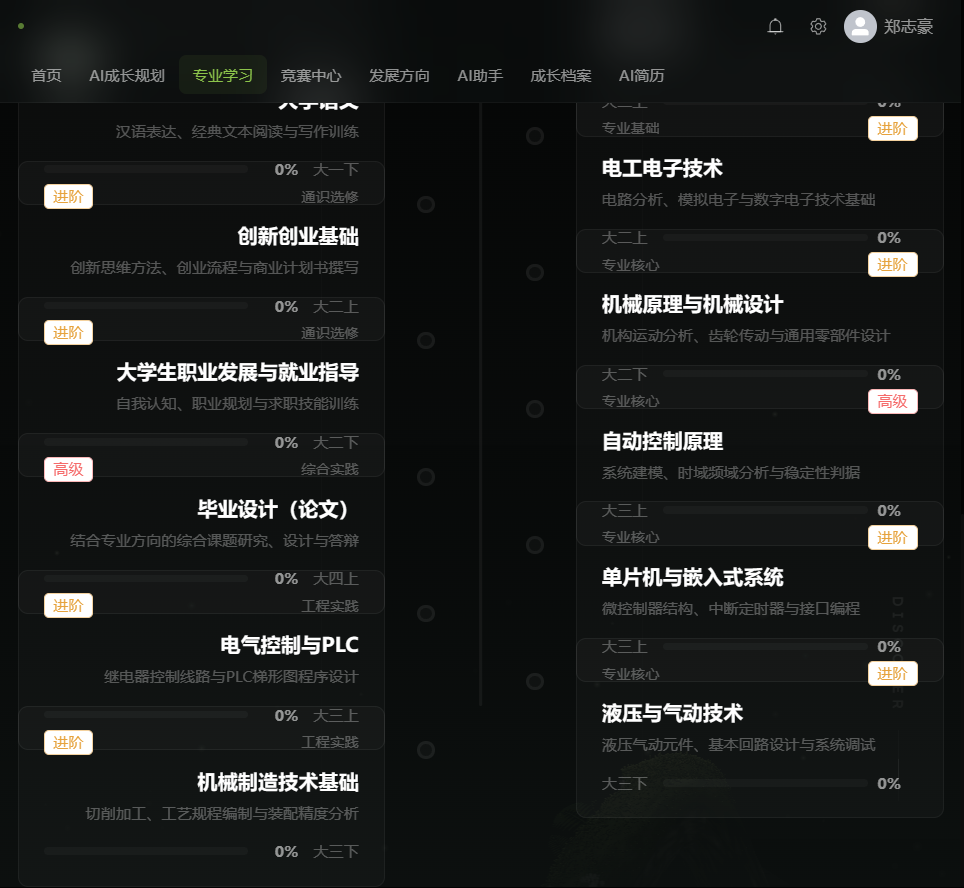

# 一、项目详情及使用方式

## 1.1 项目详情

**智途AI** 是一个 AI Native 的大学生成长规划 Web 平台。它针对大学生在成长规划上的三个真实困境——不知道自己在什么水平、不知道每个阶段该干什么、计划定了坚持不下来——把档案初始化、学生画像、四年规划、动态学习计划、竞赛推荐、简历生成串成一条闭环，并内置一个会自己调用工具查询真实数据、且把推理依据完整摆出来的成长 Agent。

与市面上「套壳 AI 聊天」作品的本质区别在于：本平台的 AI 回答**不是大模型凭空生成的**，而是由 Agent 运行时驱动大模型调用 8 个只读工具（档案、画像、课程、竞赛、学习计划、成长记录、知识库、规划），每一步工具调用都返回数据库里的真实数据；回答结束后，前端展开「执行依据」卡片，展示调用了哪些工具、参考了哪些知识库片段、事实校验结果。模型说的每一个数字都能找到出处。

**核心数据**：覆盖 175 个专业、19 个专业方向；101 场真实竞赛内置种子数据；本地 RAG 知识库 4200+ 片段；后端 57 个单元测试全部通过；26 个专业两轮批量回归验证。

## 1.2 使用方式

### 演示账号

| 角色 | 手机号 | 密码 |
| --- | --- | --- |
| 学生（数据完整，推荐演示） | 13800000000 | 123456 |
| 管理员 | 13900000000 | 123456 |

### 三种运行方式

1. **便携版（推荐评委使用）**：解压作品包中的 `智途AI-便携版` 目录，双击 `启动智途AI.bat`，浏览器访问 `http://localhost:8080`。内嵌 H2 数据库，免安装 MySQL、免配置。
2. **源码运行**：后端 `mvn spring-boot:run`，前端 `npm run dev`，按 README 配置即可。
3. **Docker Compose**：`docker compose up -d --build` 一条命令拉起 MySQL + 后端 + 前端。

### AI 能力说明

平台支持双引擎诚实降级：

- **配置 API Key**：在「API 设置」页填入任意 OpenAI 兼容协议的 Key（DeepSeek / 通义 / 豆包等），Agent 由大模型自主决策调用哪些工具，回答为流式输出。
- **未配置 Key**：自动切换本地规则编排引擎，工具照样真实执行、数据照样来自数据库，页面明确标注当前不是大模型输出。评委在没有 Key 的环境下也能完整体验全部功能。

## 1.3 典型使用路径

登录 → 档案初始化（专业/年级/GPA/目标 + 九维能力自评）→ 一键生成学生画像与四年规划 → 每周动态学习计划（打卡后 AI 重排）→ 竞赛中心查看对口赛事 → AI 成长助手提问（展开「执行依据」看工具轨迹与引用来源）→ 拍照录入证书（AI 抽取字段、人工核对后入库）→ 一键生成简历。

# 二、项目亮点

## 2.1 不是 API 调用，是真正的 Agent

平台实现了完整的五阶段 Agent 流水线：安全护栏 → RAG 检索 → 工具循环（≤4 轮）→ 流式合成 → 事实校验。大模型通过 Function Calling 协议自主决定调用哪些工具，工具返回的数据注入下一轮上下文。回答不是「生成出来的」，而是「查出来的」。

## 2.2 工具轨迹全程可视化

前端将 Agent 的思考过程渲染为「执行依据」卡片：每一步调用了哪个工具、传入什么参数、返回什么真实数据、引用了知识库哪些片段、事实校验是否通过。**这是本平台与「套壳聊天」作品最直观的区别。**

## 2.3 专业对口深度

- 175 个专业映射到 19 个专业方向，档案自评选项、课程库、竞赛推荐、规划内容全部按方向动态生成——英语专业看到听力/口语/翻译，法学专业看到法条/案例/模拟法庭，不会出现给文科生推编程能力自评的错配。
- 竞赛推荐采用三级匹配器（EXACT 精确对口 / OPEN 不限专业 / RELATED 同大类），先按对口程度分档、再按综合评分排序，避免不限专业的比赛挤掉真正为本专业办的比赛。

## 2.4 负责任的 AI

- 注入攻击拦截、敏感信息脱敏、防幻觉校验（答案中的数字必须在工具返回数据中出现）。
- 图像识别结果强制人工核对后才入库，简历数据不允许静默写入。
- 语音识别使用浏览器原生 Web Speech API，数据不出本机。

## 2.5 体验完整性

动态 Canvas 知识网络背景贯穿全站、NDJSON 流式输出、语音输入与朗读、ECharts 能力雷达图、简历打印预览。未配置 Key 时功能零阉割。

# 三、AI 技术落地使用情况概述

| AI 能力 | 落地场景 | 实现方式 |
| --- | --- | --- |
| **LLM Agent** | AI 成长助手 | 自研 AgentRuntime：护栏→RAG→工具循环≤4轮→流式合成→事实校验 |
| **Function Calling** | 8 个只读工具 | 一份定义两套出口：OpenAI tools 协议 + MCP manifest |
| **RAG 检索增强** | 知识问答引用溯源 | 零依赖本地实现：BM25(55%) + 128 维哈希向量余弦(45%)，4200+ 片段 |
| **多模态（视觉）** | 证书/奖状拍照录入 | visionForUser 接口抽取字段，人工核对后入库 |
| **多模态（语音）** | 语音输入/朗读 | Web Speech API，本地识别 |
| **AI 安全护栏** | 全站 | 注入正则拦截、脱敏、防幻觉 LCS 校验、JSON 自修复 |
| **降级与兜底** | 无 Key 环境 | 本地规则编排引擎，工具真实执行，诚实标注来源 |
| **MCP 协议** | 能力外放 | 独立 Node.js MCP Server（stdio JSON-RPC），initialize/tools/list/tools/call 全部通过 |

# 四、项目关键技术

## 4.1 技术栈

- **后端**：Java 17 / Spring Boot 2.7 / MyBatis-Plus / Spring Security + JWT / H2（演示）与 MySQL 8（生产）
- **前端**：Vue 3 / Vite 5 / Pinia / Element Plus 2 / ECharts / 原生 Web Speech API
- **AI 层**：OpenAI Chat Completions 兼容协议、NDJSON 流式事件、Function Calling、MCP 协议（Model Context Protocol）
- **工程化**：Maven 3.9 / manualChunks 前端分包 / Docker Compose 一键部署 / 57 个单元测试

## 4.2 关键设计

1. **Agent 运行时（AgentRuntime）**：五阶段流水线，NDJSON 事件流逐帧推送给前端，前端实时渲染阶段提示（正在检索知识库 → 正在调用工具 → 正在整合资料）。
2. **工具注册表（ToolRegistry）**：8 个工具用一份 JSON Schema 同时导出 OpenAI tools 定义和 MCP manifest，保证两个协议下行为一致。
3. **零依赖 RAG**：不引入向量数据库，BM25 词频 + 哈希向量余弦双路召回按权重融合，启动时对 4200+ 语料片段建索引。
4. **三级竞赛匹配器（CompetitionMajorMatcher）**：EXACT/OPEN/RELATED 分档后按「专业对口度 + 难度匹配 + 年级匹配 + 时间充裕度」加权排序。
5. **事实校验（AiGuard）**：答案中的关键数字与工具返回做 LCS 匹配，找不到出处的数字会被标记为存疑。
6. **换专业数据自愈**：保存档案时按新方向显式清空旧方向自评，画像与 Agent 工具按方向动态选数据源，杜绝跨专业污染。

# 五、项目相关图片

登录页：动态知识网络背景 + 演示账号一键填充。

首页：成长闭环六节点，档案/规划/竞赛/简历进度实时推进。

竞赛推荐：三级对口标记（精确对口/不限专业/同大类）+ 评分理由。

课程自动匹配：按专业方向动态生成，覆盖 175 个专业。

管理后台：用户管理、数据概览、级联清理。

# 六、项目发表或获奖情况

本项目为本团队 2026 年为第九届传智杯 AI WEB 网页开发挑战赛开发的原创作品，**未在任何期刊、会议公开发表，未获得过其他赛事奖项**。

# 七、项目优化与原创说明

本项目以基础的前后端脚手架为起点，以下核心模块均为本团队原创实现：

1. **Agent 运行时与工具系统**（约 3000 行）：五阶段流水线、8 个只读工具、NDJSON 事件流、无 Key 降级编排，完全自研。
2. **RAG 检索与引用溯源**：零依赖 BM25 + 哈希向量双路融合检索，4200+ 片段本地建索引。
3. **专业方向体系**：175 个专业到 19 个方向的映射表、按方向动态生成的课程/自评/竞赛模板，全部人工梳理。
4. **三级竞赛匹配器与五档离线评分**：自研算法。
5. **安全护栏与事实校验**：注入拦截、脱敏、LCS 防幻觉校验，自研。
6. **前端动态知识网络背景**：Canvas 粒子系统自研，非现成组件。
7. **MCP Server**：独立 Node.js 实现，可运行、可对接标准 MCP 客户端。

除 Spring Boot / Vue / Element Plus / ECharts 等业界通用开源框架外，业务代码与 AI 层均为原创，未使用任何「开箱即用」的 AI 应用模板。
