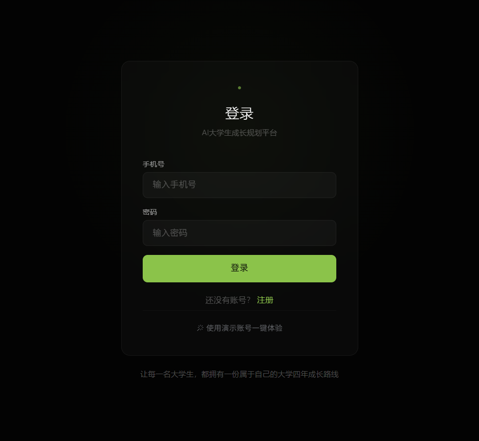
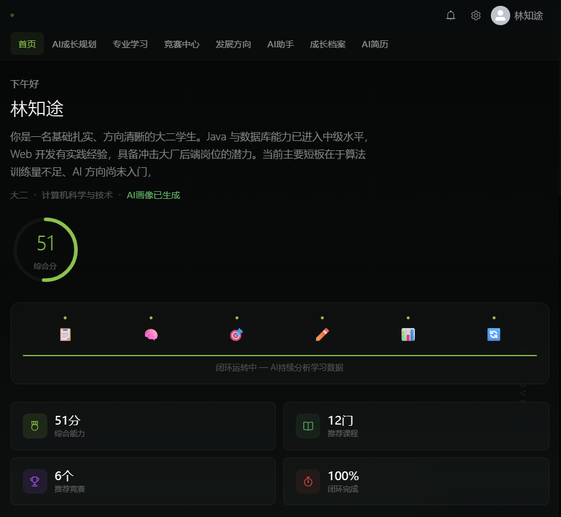
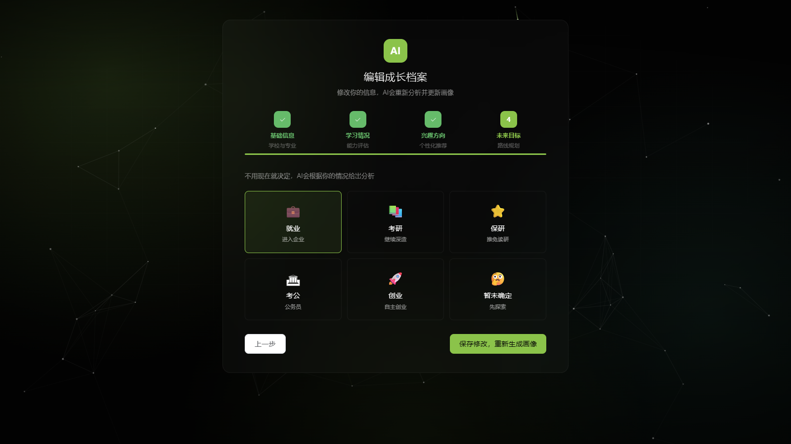
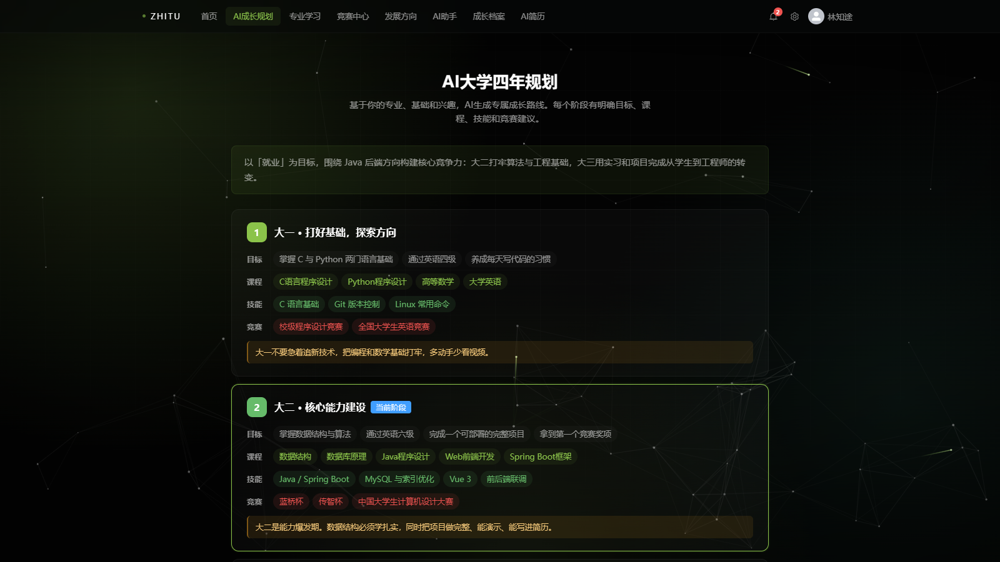
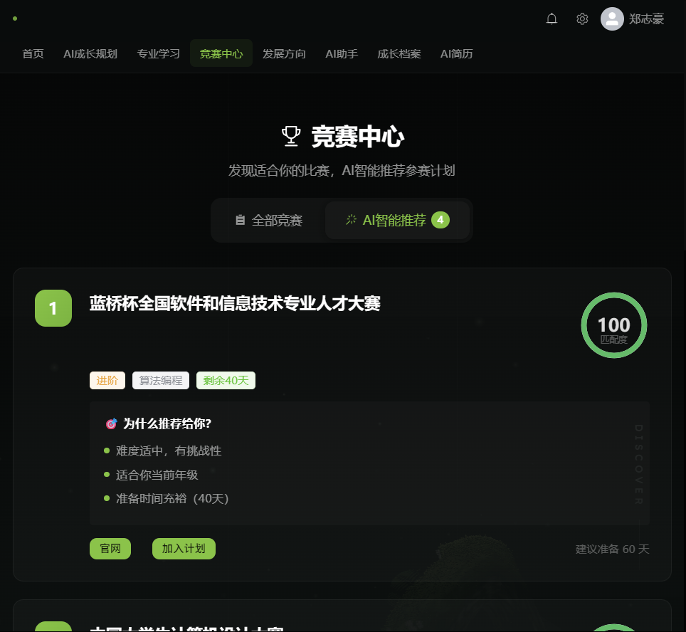
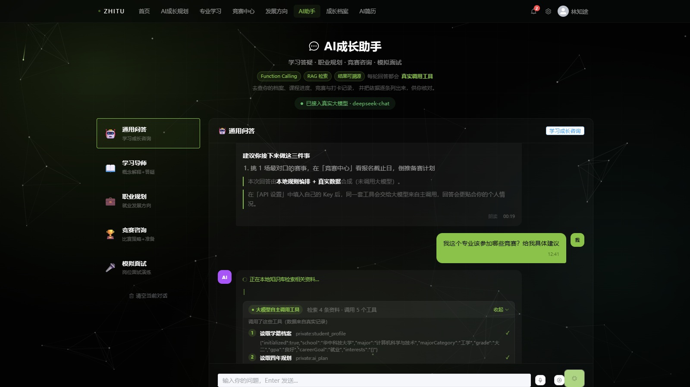
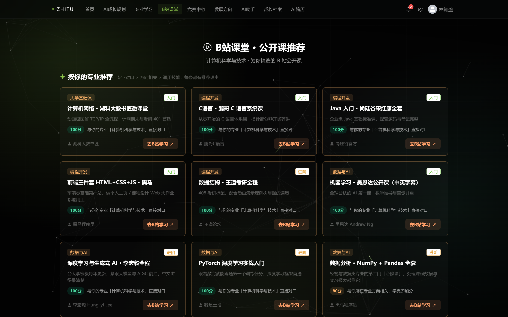
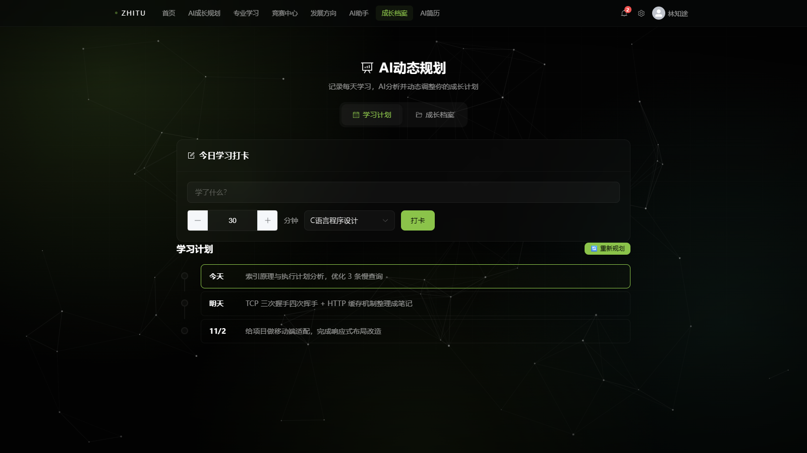
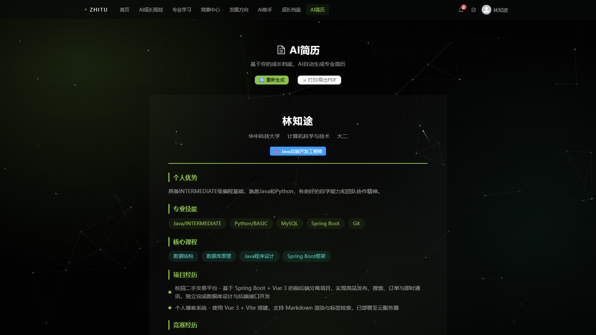
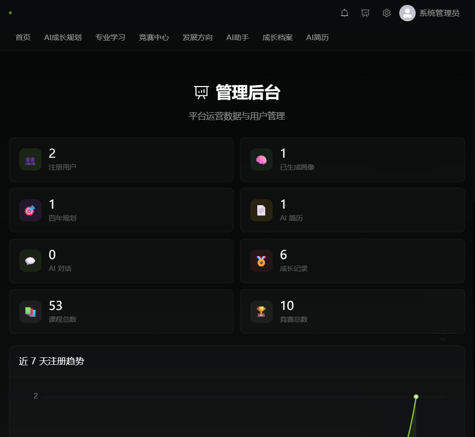

<h1>智途AI · 作品介绍文档</h1>

面向大学生的一站式 AI 成长规划平台：档案 → 画像 → 四年规划 → 动态学习计划 → 竞赛推荐 → B站课程学习 → 简历生成

175 个专业 · 19 个专业方向 · 101 场真实竞赛 · 262 门 B 站公开课（专业全覆盖） · 4200+ 知识库片段 · 后端 138 个单元测试全部通过

# 一、项目详情及使用方式

## 1.1 项目背景与定位

### 当代大学生的真实成长困境

团队在立项前访谈了身边 40 余名不同年级、不同专业的同学，加上我们自己四年里的切身体会，发现当代大学生的成长焦虑可以归结为四个字——**没有方向**。具体表现为三个普遍问题：

**问题一：不知道学什么。** 高中阶段所有目标都被简化成"提分"，进入大学后突然要面对"专业深耕？跨方向发展？考研、就业还是考公？"的多岔路口，没有人告诉他们每条路需要什么能力。于是"什么火学什么"：前两年一窝蜂学 Python，这两年又扎堆报大模型课，学了一堆工具却拼不成体系。

**问题二：没有规划，也不会规划。** 培养方案是学校发的，但那是"这个专业四年的课表"，不是"我这个人的四年"。自我认知（我强在哪、弱在哪）、阶段目标（大二该做什么）、资源匹配（我的专业适合哪些竞赛、去哪补短板）——这三件事之间没有任何工具把它们连起来。绝大多数学生的"规划"只存在于开学第一周的雄心壮志里。

**问题三：只会跟着别人走。** 室友报蓝桥杯，自己也报；同学考研，自己也考。选竞赛不看专业对口度，选课程不看自身短板，跟着走的成本看似最低，四年下来却攒下一份"样样都碰过、样样不精"的简历。而市面上的工具要么只做静态课表，要么是"套壳 AI 聊天"——回答由大模型凭空生成，无法追溯依据，也不敢用于真实决策。

### 我们做什么

**智途AI** 是一个 AI Native 的大学生成长规划 Web 平台，把档案初始化、学生画像、四年规划、动态学习计划、竞赛推荐、B 站课程学习、成长记录、简历生成串成一条完整闭环，并内置一个**会自己调用工具查询真实数据、且把推理依据完整摆出来的成长 Agent**。

针对上面三个问题，平台的回答分别是：

| 大学生困境 | 智途AI 的回答 |
| --- | --- |
| 不知道学什么 | 九维能力自评 + AI 画像诊断先看清自己，再按专业方向生成对口的学习路径与 262 门按专业精确匹配的 B 站公开课，弱项优先补 |
| 没有规划 | 按专业方向内置四年规划模板，落到每周可执行的动态计划，打卡后 AI 重排，计划不再停在第一周 |
| 只会跟着别人走 | 101 场真实竞赛按"专业对口度 + 难度 + 年级 + 时间充裕度"三级匹配个性化推荐，推荐理由逐条可见，不再"别人报我也报" |

与"套壳聊天"类作品的本质区别：本平台的 AI 回答**不是生成出来的，而是查出来的**。Agent 运行时驱动大模型通过 Function Calling 自主调用 9 个只读工具（档案、画像、课程、B站资源、竞赛、学习计划、成长记录、知识库、规划），每一步都返回数据库中的真实数据；回答结束后前端展开「查看依据」卡片，展示调用了哪些工具、传了什么参数、引用了知识库哪些片段、事实校验是否通过。模型说的每一个数字都能找到出处。

## 1.2 功能闭环

| 环节 | 能力 | AI 参与方式 |
| --- | --- | --- |
| 档案初始化 | 专业/年级/GPA/目标 + 九维能力自评 | 自评项按专业方向动态生成（英语专业看到听力/口语/翻译，法学专业看到法条/案例/模拟法庭） |
| 学生画像 | 能力雷达图、优势与短板诊断 | LLM 基于真实档案数据生成，禁止编造未提供的信息 |
| 四年规划 | 分学年目标、课程、证书、实习建议 | 按 19 个专业方向分别内置规划模板 |
| 学习计划 | 周计划 + 打卡 + AI 重排 | 打卡后调用 AI 重新评估进度并调整下周计划 |
| 竞赛中心 | 101 场真实赛事 + 三级对口推荐 + **报名入口直达** | 三级匹配器（精确对口/不限专业/同大类）+ 五档离线评分；`CompetitionRegistrationLink` 按赛事解析官方报名系统 / 校内报名通知，页面、AI 推荐与助手共用同一入口 |
| B站课堂 | 262 门公开课 · 覆盖全部 175 个专业 + 分层精准推荐 | 独立自研的 `CourseMajorRelevance`（精确对口 100 / 近亲 80 / 真通用 60，不对口一律不推）与 `BilibiliRecommendPolicy`（对口课优先占满，近亲最多 3 门、通用最多 2 门只做补位）；`scripts/gen-bilibili-seed.py` 硬校验每个专业名都来自专业字典、每个专业至少 3 门对口课；同为对口课时按「标题命中专业核心词」排序，心理学第一屏是普通心理学而非高数；页面与 Agent 工具共用同一套规则，每条推荐给出可核对的理由 |
| 成长档案 | 学习打卡、证书拍照录入、语音录入 | 视觉抽取字段（人工核对后入库）、浏览器本地语音识别 |
| 简历生成 | 一键汇总生成 A4 简历，**支持在线编辑、下载独立文件与白底打印导出 PDF** | 汇总真实档案与成长记录，不静默写入未经确认的数据；`PUT /api/resume` 按白名单清洗字段后落库，刷新不丢失 |

## 1.3 使用方式

**演示账号**（数据完整，推荐评委直接体验）

<b>学生账号</b>　手机号 13800000000　密码 123456　　<b>管理员账号</b>　手机号 13900000000　密码 123456

**三种运行方式**

1. **便携版（推荐评委使用）**：先把作品包**完整解压**到任意文件夹，进入 `便携版-双击即用` 目录，双击 `启动智途AI.bat`（若窗口中文显示乱码，改用同目录纯英文的 `start-en.bat`），浏览器自动打开 `http://localhost:8080`；若 8080 被占用，脚本自动改用 8090，以窗口显示的地址为准。唯一前提是装了 Java（8 / 11 / 17 / 21 均可，已实测三个版本，推荐 JDK 17），内嵌 H2 数据库自动建库，免安装 MySQL、Node.js、Maven，也无需 API Key。关闭黑色命令行窗口即停止服务。
2. **源码运行**：后端 `mvn spring-boot:run`，前端 `npm run dev`，按根目录 README 配置即可。
3. **Docker Compose**：`docker compose up -d --build` 一条命令拉起 MySQL + 后端 + 前端。

**AI 能力双引擎诚实降级**

- **配置 API Key**：在「API 设置」页填入任意 OpenAI 兼容协议的 Key（DeepSeek / 通义 / 豆包等均可），Agent 由大模型自主决策调用哪些工具，回答为流式输出，可展开完整执行依据。
- **未配置 Key**：自动切换本地规则编排引擎，工具照样真实执行、数据照样来自数据库，页面明确标注当前非大模型输出。评委在没有 Key 的环境下也能完整体验全部功能，不存在功能阉割。

**典型使用路径**：登录 → 档案初始化 → 一键生成画像与四年规划 → 每周动态学习计划（打卡后 AI 重排）→ 首页「竞赛报名」快捷入口直达报名中赛事 → 竞赛中心一键报名 → B站课堂按专业领取对口公开课 → AI 成长助手提问并展开「查看依据」→ 拍照录入证书 → 一键生成简历 → 在线编辑并下载独立简历文件。

# 二、项目亮点

**亮点一：不是 API 调用，是真正的 Agent。** 完整实现五阶段 Agent 流水线——安全护栏 → RAG 检索 → 工具循环（≤4 轮）→ 流式合成 → 事实校验。大模型自主决定调用哪些工具，工具返回的数据注入下一轮上下文，形成"思考—调用—再思考"的闭环，而非单轮问答。

**亮点二：工具轨迹全程可视化。** 前端将 Agent 的思考过程渲染为「查看依据」卡片：调用了哪些工具、传入什么参数、返回什么真实数据、引用了知识库哪些片段、事实校验是否通过。这是本平台与"套壳聊天"作品最直观的区别，也是评委可以快速验证的一点。

**亮点三：专业对口深度。** 175 个专业映射到 19 个专业方向，档案自评选项、课程库、竞赛推荐、B 站课程推荐、规划内容全部按方向动态生成，不会出现给文科生推编程能力自评的错配。竞赛推荐采用三级匹配器，先按对口程度分档、再按综合评分排序，避免"不限专业"的比赛挤掉真正为本专业办的比赛。26 个专业两轮批量回归验证，方向判定全部正确。

**亮点四：学习资源闭环——校内课表 + 校外 B 站公开课。** 专业学习页的"知识地图"回答**该学什么**（3900+ 门课程、按学期排列的学习路线），新增的 B站课堂回答**去哪学**（262 门大学生口碑公开课：宋浩高数、湖科大计网、王道数据结构、吴恩达机器学习、王佩丰 Excel 等，覆盖 13 个类别与全部 175 个专业，每个专业至少 3 门精确对口课）。课程推荐采用独立的专业相关度规则（不复用竞赛的学科大类，避免"心理学收到机器学习"这类错配），并按贴合度分层：标题命中专业核心词的纯专业课本排在最前，心理学第一屏是普通心理学 / 实验心理学，口腔医学第一屏是口腔解剖生理学 / 口腔组织病理学；每门课都标注"专业对口 / 相近专业 / 通用技能"与"为什么推荐给你"；AI 助手被问"高数去哪学"时调用 `search_bilibili_courses` 工具返回真实链接，出现在「查看依据」中可追溯。链接采用"课程名 + UP 主"的 B 站搜索直达而非固定 BV 号——视频会下架，搜索组合不会，评委点开永远不是死链。

**亮点五：从「知道报哪个」到「一键去报名」。** 竞赛卡片原本只有一个「官网」文字按钮，点进去往往是主办单位门户首页——蓝桥杯的门户 `lanqiao.cn` 与报名系统 `dasai.lanqiao.cn`、传智杯的集团站 `itcast.cn` 与报名通道 `boxuegu.com/match` 都不是同一个地址，学生还得自己翻通知。新增的 `CompetitionRegistrationLink` 把 101 场赛事按三类渠道统一解析：有独立报名系统的直达官方报名页、由学校统一组织的直达「赛事名 + 报名通知」检索结果、仅发通知的直达官网通知页；同时输出「报名中 / 即将开放 / 已截止」状态与渠道说明。页面顶部显示「N 场赛事正在报名」并支持一键筛选，首页「竞赛报名」快捷入口直接落到报名中列表；AI 推荐卡片、Agent 工具与 RAG 检索文本共用同一套入口，助手消息里的链接自动转成可点链接。所有报名字段为运行时计算、不落库——报名系统每年换域名也不会在老用户的 `data/` 目录里留下死链，H2 / MySQL / 分布式三档部署行为一致；4 个官方报名入口已实测 HTTP 200。

**亮点六：负责任的 AI。** 注入攻击拦截、敏感信息脱敏、防幻觉校验（答案中的数字必须在工具返回数据中出现，否则标记为存疑）；图像识别结果强制人工核对后才入库；语音识别使用浏览器原生 Web Speech API，数据不出本机。

**亮点七：零依赖自研 RAG。** 不引入向量数据库，用 BM25 词频（权重 55%）+ 128 维哈希向量余弦（权重 45%）双路召回融合，启动时对 4200+ 语料片段建索引，检索结果带来源标注，可直接溯源。

**亮点八：体验完整性。** 动态 Canvas 知识网络背景贯穿全站、NDJSON 流式打字机输出、语音输入与朗读、ECharts 能力雷达图；简历生成后可**在线编辑并保存**、下载独立 A4 HTML 文件、打印时自动切成白底并隐藏导航；前端分包优化（vendor-core 81KB / vendor-echarts 343KB / vendor-element 966KB）。

**亮点九：第一次打开也不会卡住。** 评委常用全新账号直接点各模块。平台把「还没建档案」与「服务出错」明确分开：所有依赖专业的生成入口统一返回 409 业务状态，前端弹出可一键跳转的「去初始化」引导，各模块顶部还有常驻引导条；知识地图的空状态会区分「还没选专业」和「该专业数据补充中」，不再让人误以为课程库没做完。内部异常只写服务端日志，浏览器永远只看到稳定、可执行的提示，不会弹出 Java 空指针原文。

# 三、AI 测试技术落地使用情况概述

本作品的 AI 能力不是点缀，而是贯穿业务主线的核心驱动。下表列出每一项 AI 能力的落地场景与实现方式：

| AI 能力 | 落地场景 | 实现方式与效果 |
| --- | --- | --- |
| **LLM Agent** | AI 成长助手 | 自研 `AgentRuntime` 五阶段流水线 + 多轮对话记忆（最近 3 轮注入上下文），NDJSON 事件流逐帧推送 |
| **Function Calling** | 9 个只读工具 | 一份 JSON Schema 双重导出：OpenAI tools 协议 + MCP manifest，两个协议下行为一致 |
| **RAG 检索增强** | 知识问答与引用溯源 | 零依赖本地实现：BM25(55%) + 128 维哈希向量余弦(45%)，4200+ 片段，命中片段在「查看依据」中列出；零命中时前端明确告知 |
| **多模态（视觉）** | 证书/奖状拍照录入 | `visionForUser` 接口抽取证书字段，强制人工核对后才写入数据库 |
| **多模态（语音）** | 语音提问与朗读 | 浏览器原生 Web Speech API，本地识别，数据不出本机 |
| **AI 安全护栏** | 全站所有 AI 入口 | 注入正则拦截、手机号/身份证脱敏、LCS 防幻觉校验、JSON 自修复、滑动窗口限流（每分钟 10 次） |
| **降级与兜底** | 无 Key 环境 | 本地规则编排引擎，工具真实执行、数据真实返回，页面诚实标注当前输出来源 |
| **MCP 协议** | 能力外放 | 独立 Node.js MCP Server（stdio JSON-RPC），`initialize` / `tools/list` / `tools/call` 全部通过实测 |

**落地成效实测**：以法学专业学生提问"我该参加哪些竞赛"为例，Agent 自主调用 2 个工具，返回 17 场法律类赛事，零 IT 类越界推荐，事实校验 0 处存疑；追问"那第一个什么时候开始报名"时，多轮记忆让模型正确理解指代对象，并如实说明"赛事库不含报名日期"而非编造。问"高数去哪学"时，Agent 调用 B 站资源工具返回宋浩高数等真实课程链接，出现在「查看依据」中可点击溯源。26 个专业两轮批量回归中，仅外语方向出现过一次错配，已修复并补充单元测试。连续 12 次快速提问实测，第 10 次起触发限流保护并提示剩余等待秒数。

### AI 能力的测试与验证（测试技术落地）

为保证 AI 能力「可验证、可复现」，本作品建立了三层测试体系：

| 层次 | 手段 | 覆盖内容与结果 |
| --- | --- | --- |
| 单元测试 | JUnit 5 + Mockito | 后端 **138 个单元测试全部通过**，覆盖 Agent 运行时、9 个工具的 Function Calling 行为、RAG 检索、事实校验、限流护栏、专业匹配器、B 站推荐策略、简历白名单清洗、全局异常处理等 |
| 数据与规则回归 | 读取真实种子 SQL 的反向校验测试 | 262 门 B 站课程覆盖全部 175 个专业、每专业至少 3 门对口课；16 个竞赛官方报名入口白名单；教资类课程只面向教育学门类，避免跨专业蹭课 |
| 端到端巡检 | Playwright 全新账号自动化走查 | 首页、档案、画像、四年规划、学习计划、竞赛、B 站课堂、成长档案、简历、管理后台共 10 个页面逐一验证；同时复核无档案时的 409 引导、换专业后的数据清理、简历保存与打印导出 |

针对「AI 会不会编造」这一核心质疑，回答生成后由 LCS 事实校验器逐句比对工具返回与知识库片段，命中不足时在「查看依据」中显式标注存疑，而不是静默输出。未配置 API Key 时的本地规则编排引擎与大模型模式共用同一套工具实现，因此评委在离线环境下看到的推荐结果同样被上述测试覆盖。

**运行环境兼容性实测**：同一份 `zhitu-ai.jar` 分别在 Java 8（1.8.0_202）、Java 17（Temurin 17.0.20.1）、Java 21（21.0.10）上启动，三次均成功打印 `Started ZhituApplication` 且首页返回 HTTP 200，启动耗时 4–6 秒，证明交付包不依赖特定 JDK 版本。

# 四、项目关键技术

## 4.1 技术栈

- **后端**：Java 17 / Spring Boot 2.7 / MyBatis-Plus / Spring Security + JWT / H2（演示）与 MySQL 8（生产）
- **前端**：Vue 3 / Vite 5 / Pinia / Element Plus 2 / ECharts / 原生 Web Speech API / Canvas 粒子系统
- **AI 层**：OpenAI Chat Completions 兼容协议、NDJSON 流式事件、Function Calling、MCP（Model Context Protocol）
- **工程化**：Maven 3.9 / Vite manualChunks 分包 / Docker Compose 一键部署 / 138 个单元测试

## 4.2 六个关键设计

1. **Agent 运行时（AgentRuntime）**：五阶段流水线，NDJSON 事件流逐帧推送给前端，前端实时渲染阶段提示，用户能看到 AI"正在做什么"而非干等。
2. **工具注册表（ToolRegistry）**：9 个工具用一份 JSON Schema 同时导出 OpenAI tools 定义与 MCP manifest，避免两套定义行为漂移。
3. **零依赖 RAG（RagService）**：BM25 词频 + 哈希向量余弦双路召回按权重融合，启动时对 4200+ 语料片段建索引，无需外部向量库。
4. **三级竞赛匹配器（CompetitionMajorMatcher）**：EXACT / OPEN / RELATED 分档后，按"专业对口度 + 难度匹配 + 年级匹配 + 时间充裕度"加权排序，解决推荐顺序错乱问题。
5. **事实校验（AiGuard）**：答案中的关键数字与工具返回数据做 LCS（最长公共子串）匹配，找不到出处的数字被标记为存疑并提示用户。
6. **换专业数据自愈**：保存档案时按新方向显式清空旧方向自评，画像与 Agent 工具按方向动态选数据源，杜绝跨专业数据污染（如从医学转到计算机后残留旧自评）。

# 五、项目相关图片

<figure><figcaption>登录页：动态知识网络背景 + 演示账号一键填充</figcaption></figure>
<figure><figcaption>首页：成长闭环六节点，进度实时推进</figcaption></figure>

<figure><figcaption>档案初始化：能力自评项按专业方向动态生成</figcaption></figure>
<figure><figcaption>学习计划：周计划 + 打卡，打卡后 AI 重排</figcaption></figure>

<figure><figcaption>竞赛推荐：三级对口标记 + 评分理由</figcaption></figure>
<figure><figcaption>AI 助手「查看依据」：工具调用轨迹、引用来源、事实校验</figcaption></figure>

<figure><figcaption>B站课堂：按专业推荐公开课，每门课标注匹配分数与推荐理由，链接直达 B 站</figcaption></figure>

<figure><figcaption>成长档案：学习打卡与证书拍照录入</figcaption></figure>
<figure><figcaption>简历中心：一键汇总生成可打印简历</figcaption></figure>

<figure><figcaption>管理后台：用户管理、数据概览、级联清理</figcaption></figure>

# 六、项目发表或获奖情况

本项目为本团队 2026 年为第九届传智杯 AI WEB 网页开发挑战赛开发的原创作品，已按赛程完成**预指导阶段**作品提交，**此前未在任何期刊、会议公开发表，未获得过其他赛事奖项，也未用于其他商业用途**。全部代码与文档均为本团队独立开发，知识产权清晰。

# 七、项目优化与原创说明

本作品以通用的前后端脚手架（Spring Boot 初始化项目 + Vue 3 基础工程）为起点，以下核心模块**均为本团队原创设计与实现**：

1. **Agent 运行时与工具系统**（约 3000 行）：五阶段流水线、9 个只读工具、NDJSON 事件流、无 Key 降级编排，完全自研，未使用任何 Agent 框架。
2. **RAG 检索与引用溯源**：零依赖 BM25 + 哈希向量双路融合检索，4200+ 片段本地建索引，检索结果带来源标注。
3. **专业方向体系**：175 个专业到 19 个方向的映射表、按方向动态生成的课程/自评/竞赛/规划模板，全部人工梳理。
4. **三级竞赛匹配器与五档离线评分**：自研匹配与评分算法，解决"推荐顺序错乱""分数全相同的"问题。
5. **安全护栏与事实校验**：注入拦截、脱敏、LCS 防幻觉校验、JSON 自修复，自研。
6. **B 站公开课资源库**：262 门课程的搜集、分类、专业映射（suitable_major JSON）与"搜索直达"链接策略为团队人工梳理与设计；`scripts/gen-bilibili-seed.py` 是 H2 / MySQL 两份种子 SQL 的唯一生成入口，负责专业名合法性、175 个专业覆盖率与字段长度校验。推荐引擎为针对课程场景自研的 `CourseMajorRelevance` + `BilibiliRecommendPolicy`，页面推荐与 Agent 工具共用同一份规则，并有覆盖率单测直接读取生成的 SQL 反向校验。
7. **前端动态知识网络背景**：Canvas 粒子系统自研，非现成组件。
8. **MCP Server**：独立 Node.js 实现，可运行、可对接标准 MCP 客户端。
9. **多轮测试中发现并修复的问题**：换专业后旧方向自评残留污染画像（已加显式清理 + 单元测试）；外语专业错配到汉语言文学课程（新增外语类方向，补充英语/商务英语/日语断言）；B站推荐复用竞赛学科大类导致心理学专业收到机器学习课程（改为名字级近亲判定 + 7 项回归测试）；换专业后旧画像/规划/打卡残留（saveProfile 统一清理 + 3 项测试）。

10. **交付与兼容性打磨（预指导反馈后的优化）**：新增竞赛报名入口直达（16 个官方报名白名单 + 校内通知兜底，页面、推荐与 AI 助手共用同一入口）；简历中心支持在线编辑、独立文件下载与 A4 白底打印导出；无档案时统一 409 引导并收口重复红框报错；修复专业知识地图卡片重叠（改 CSS Grid 自适应行高）；换专业后显式清理旧画像 / 规划 / 打卡；课程推荐改为严格专业相关度判定，心理学等专业不再收到机器学习、教资类课程；启动脚本统一为 GBK 编码并新增纯 ASCII 兜底脚本，保证中文 Windows 上不乱码；后端单元测试扩充至 138 项且全部通过。

除 Spring Boot / Vue 3 / Element Plus / ECharts 等业界通用开源框架外，业务代码与 AI 层均为原创，未使用任何"开箱即用"的 AI 应用模板或低代码生成方案。
